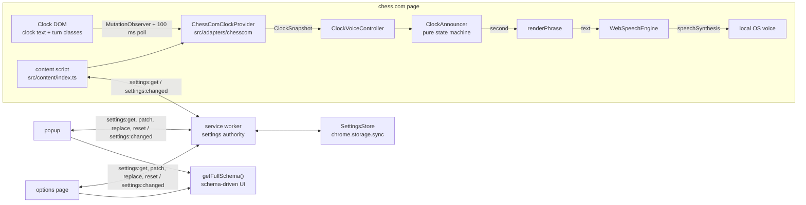

# Architecture

Chess Clock Voice is a Manifest V3 extension with one job: read the two chess.com clocks, decide when the user's clock is low, and speak the remaining time locally. The clock is the only page data the extension reads.

- [README](README.md)
- [Decisions](DECISIONS.md)
- [Selectors](docs/SELECTORS.md)
- [Settings schema](docs/SETTINGS_SCHEMA.md)
- [Contributing](CONTRIBUTING.md)
- [Publishing](PUBLISHING.md)

## System overview



There is no server, no remote code, and no network request from the extension. Speech is synthesized by the browser and operating system.

## Layers and dependency rules

| Layer           | Path               | Purpose                                                                                                 | May import                                                                         | Must not import                                                                |
| --------------- | ------------------ | ------------------------------------------------------------------------------------------------------- | ---------------------------------------------------------------------------------- | ------------------------------------------------------------------------------ |
| Core            | `src/core/`        | Event bus, logger, i18n, typed messages, time-control rules, settings schema helpers, versioned storage | Other `core/` modules and platform types                                           | `adapters/`, `features/`, `engines/`, `ui/`, `app/`, `content/`, `background/` |
| Adapters        | `src/adapters/`    | Site-specific DOM reading behind `ClockProvider`; all selectors in one file per site                    | `core/`, its own adapter modules                                                   | `features/`, `ui/`, `app/`, `content/`, `background/`                          |
| Engines         | `src/engines/tts/` | Speech output behind `TtsEngine`                                                                        | Its own types and Web APIs                                                         | Site adapters, features, UI, storage                                           |
| Features        | `src/features/`    | Self-contained product behavior, settings, schema, presets, controller                                  | `core/`, `adapters/types`, `engines/`, its own modules                             | `ui/`, `app/`, `content/`, `background/`, other features                       |
| App composition | `src/app/`         | App-level defaults, validation, migrations, full schema assembled from the feature registry             | `core/settings`, `features/registry`, feature setting exports                      | DOM, site adapters, UI components                                              |
| Background      | `src/background/`  | Single settings authority, validation, persistence, broadcasts                                          | `app/`, `core/`                                                                    | DOM, adapters, features' runtime code, UI                                      |
| Content         | `src/content/`     | Wires provider + features for the current URL, SPA remounting, settings snapshots                       | Adapter registry, feature registry, `app/settings`, `core/messages`, `core/logger` | UI components, CSS, direct `chrome.storage`                                    |
| UI              | `src/ui/`          | Popup and options page; renders schemas, maintains drafts, sends typed requests                         | `core/schema`, `core/messages`, `app/settings`, `ui/` components                   | Adapter DOM code, content/background modules, direct `chrome.storage`          |
| Tests           | `tests/`           | Unit/integration tests with jsdom and fixtures                                                          | Any module under test                                                              | —                                                                              |

The runtime rule behind these boundaries: **only the service worker touches `chrome.storage`; only an adapter touches the site DOM; only `selectors.ts` contains site selectors; only the UI renders settings controls.**

## Core interfaces

These are the contracts extension points implement. They match the source files.

### Clock provider

```ts
// src/adapters/types.ts
export type ClockSide = 'top' | 'bottom';

export interface ClockReading {
  side: ClockSide;
  seconds: number | null;
  text: string;
  isTurn: boolean;
  element: Element | null;
}

export interface ClockSnapshot {
  top: ClockReading;
  bottom: ClockReading;
  timeControl: TimeControlInfo;
  playerSide: ClockSide;
  url: string;
}

export interface ClockProvider {
  readonly id: string;
  matches(url: string): boolean;
  getClocks(): ClockSnapshot | null;
  getTimeControl(): TimeControlInfo;
  getPlayerSide(): ClockSide;
  onTick(listener: (snapshot: ClockSnapshot) => void): () => void;
  destroy(): void;
}

export interface ClockProviderFactory {
  id: string;
  matches(url: string): boolean;
  create(doc?: Document, win?: Window): ClockProvider;
}
```

`TimeControlInfo` comes from `src/core/time-control.ts`:

```ts
export type TimeControlCategory = 'bullet' | 'blitz' | 'rapid' | 'daily';
export type IncrementSource = 'time-control' | 'observed' | 'none';

export interface TimeControlInfo {
  raw: string | null;
  category: TimeControlCategory | null;
  baseSeconds: number | null;
  incrementSeconds: number;
  incrementSource: IncrementSource;
}
```

### TTS engine

```ts
// src/engines/tts/types.ts
export interface TtsVoice {
  voiceURI: string;
  name: string;
  lang: string;
  localService: boolean;
  default: boolean;
}

export interface SpeakOptions {
  voiceURI?: string;
  lang?: string;
  rate?: number;
  pitch?: number;
  volume?: number;
}

export interface TtsEngine {
  readonly id: string;
  isSupported(): boolean;
  speak(text: string, options?: SpeakOptions): void;
  cancel(): void;
  getVoices(): TtsVoice[];
  onVoicesChanged(listener: (voices: TtsVoice[]) => void): () => void;
}
```

### Feature module

`FeatureModule` is an alias of `FeatureDefinition` in `src/features/types.ts`. Features are site-agnostic; the provider determines whether the page is supported. The clock-voice feature therefore uses `matches: () => true`.

```ts
export interface FeatureContext {
  url: string;
  provider: ClockProvider;
  getSettings: () => AppSettings;
  logger: Logger;
}

export interface FeatureHandle {
  dispose(): void;
  onSettingsChanged?(settings: AppSettings): void;
}

export interface FeatureDefinition {
  id: string;
  nameKey: string;
  matches(url: string): boolean;
  init(context: FeatureContext): FeatureHandle;
  settings: {
    schema: SettingsSchema;
    defaults: unknown;
    normalize(raw: unknown): unknown;
    validate(settings: AppSettings): SettingsError[];
  };
  builtInPresets?: BuiltInPreset[];
}

export type FeatureModule = FeatureDefinition;
```

### Presets

```ts
// src/features/clock-voice/settings.ts
export type Cadence = 'every' | 'panic' | 'milestones';

export interface CustomPreset {
  id: string;
  name: string;
  description: string;
  phrase: string;
  cadence: Cadence;
  milestones: number[];
  rate?: number;
  createdAt: number;
}

// src/features/clock-voice/presets.ts
export interface BuiltInPreset {
  id: string;
  nameKey: string;
  descriptionKey: string;
  phrase: string;
  cadence: Cadence;
  milestones: number[];
  rate?: number;
}

export type Preset = BuiltInPreset | CustomPreset;
```

### Settings schema

```ts
// src/core/settings/types.ts
export interface AppSettings {
  version: number;
  masterEnabled: boolean;
  features: Record<string, unknown>;
}

export interface SettingsError {
  path: string;
  code: string;
  params?: Record<string, string | number>;
}

export type Surface = 'popup' | 'options';

// src/core/settings/schema.ts
export interface SchemaOption {
  value: string;
  labelKey: string;
}

interface BaseField {
  path: string;
  labelKey: string;
  helpKey?: string;
  surfaces?: Surface[];
}

export type SettingsField =
  | (BaseField & { kind: 'boolean' })
  | (BaseField & { kind: 'select'; options: SchemaOption[]; inline?: boolean })
  | (BaseField & {
      kind: 'slider';
      min: number;
      max: number;
      step: number;
      unitKey?: string;
      showInput?: boolean;
    })
  | (BaseField & { kind: 'number'; min: number; max: number; step: number; unitKey?: string })
  | (BaseField & {
      kind: 'text';
      maxLength?: number;
      placeholderKey?: string;
      tokens?: string[];
      showSpeechMetrics?: boolean;
    })
  | (BaseField & { kind: 'numberList'; min: number; max: number; placeholder?: string })
  | (BaseField & { kind: 'voice'; langPath: string })
  | (BaseField & {
      kind: 'action';
      action: 'test-voice' | 'open-options' | 'reset-settings';
      variant?: 'primary' | 'secondary' | 'ghost';
    })
  | (BaseField & { kind: 'preset-gallery' })
  | (BaseField & { kind: 'info'; textKey: string });

export interface SettingsSection {
  id: string;
  titleKey: string;
  descriptionKey?: string;
  fields: SettingsField[];
  surfaces?: Surface[];
}

export interface SettingsSchema {
  sections: SettingsSection[];
}
```

## Typed message catalog

All runtime messages are defined in `src/core/messages.ts`.

| Message            | Direction                                                | Payload                    | Response / effect                                                                                     |
| ------------------ | -------------------------------------------------------- | -------------------------- | ----------------------------------------------------------------------------------------------------- |
| `settings:get`     | content → service worker; popup/options → service worker | none                       | `ApiResponse<AppSettings>`; reads, migrates, normalizes, writes back if needed                        |
| `settings:patch`   | popup/options → service worker                           | `DeepPartial<AppSettings>` | Validates the merged result, persists, broadcasts, returns `ApiResponse<AppSettings>`                 |
| `settings:replace` | popup/options → service worker                           | `AppSettings`              | Validates the complete candidate, persists, broadcasts, returns `ApiResponse<AppSettings>`            |
| `settings:reset`   | popup/options → service worker                           | none                       | Restores defaults, persists, broadcasts, returns `ApiResponse<AppSettings>`                           |
| `settings:changed` | service worker → extension pages and chess.com tabs      | `AppSettings`              | No response; content replaces its in-memory snapshot and calls each `FeatureHandle.onSettingsChanged` |

```ts
export type RequestMessage =
  | { type: 'settings:get' }
  | { type: 'settings:patch'; patch: DeepPartial<AppSettings> }
  | { type: 'settings:replace'; settings: AppSettings }
  | { type: 'settings:reset' };

export interface SettingsChangedMessage {
  type: 'settings:changed';
  settings: AppSettings;
}

export type RuntimeMessage = RequestMessage | SettingsChangedMessage;

export type ApiResponse<T> = { ok: true; data: T } | { ok: false; error: ApiErrorBody };
```

Errors use `{ code, message, errors? }` where `errors` is `SettingsError[]`. Validation failures use the code `validation_error`. The UI does not use a separate “get schema” message; it imports `getFullSchema()` locally and renders it.

## One announcement, end to end

1. `ChessComClockProvider` starts when the content script mounts on a matching URL. It attaches a `MutationObserver` to `document.documentElement` and a 100 ms interval fallback.
2. The observer/poll schedules a 30 ms debounced read. The provider reads the two clock containers, the clock text, active-turn classes, the time-control label, and any observed increment.
3. If the snapshot signature changed, the provider emits `tick` on its typed event bus. `ClockVoiceController` receives the `ClockSnapshot`.
4. The controller checks `masterEnabled`, resolves the time-control category (parsed category, then clock-based fallback), and checks that category's `enabled` flag.
5. It maps `settings.clockScope` to the target side(s): `mine` → `snapshot.playerSide`; `opponent` → the other side; `both` → both. A side must be `isTurn` and have a parsed `seconds`.
6. The controller tracks when each side started its turn. It suppresses ticks during `settleMs` so a clock does not speak during the first moments after a move.
7. `ClockAnnouncer.tick()` applies the effective threshold, whole-second de-duplication, cadence, increment-jump reset, and settle windows. It returns `{ announce, second }`.
8. `renderPhrase()` replaces `{seconds}`, `{increment}`, and `{timeControl}`. `{seconds}` is the whole second that triggered the announcement.
9. `WebSpeechEngine.speak()` calls `speechSynthesis.cancel()`, then speaks one utterance with the selected voice, language, rate, pitch, and volume. The controller also drops identical text within 800 ms and any utterance within 200 ms of the previous one.
10. Nothing is queued, stored, or sent anywhere. If speech synthesis is unavailable, a warning is logged once and the controller stays silent.

## Increment handling

There are two distinct mechanisms; both feed the same effective threshold.

### 1. Reading the increment

- The time-control label is parsed eagerly: `3|2`, `3+2`, `10+5`, `3 min`, `30 sec`, `1 day`, and `10 min (5 sec increment)` are supported.
- A paired label is interpreted as minutes when it contains `min` or when the base number is `<= 60`; otherwise the base is seconds.
- If the label has no increment, the provider learns from clock jumps: a positive jump of **0.8–15 seconds** on either side is treated as an increment and rounded when it is within 0.25 s of a whole number.
- Jump learning is intentionally capped at 15 s. Larger jumps are treated as a new game/reset and are not learned as increments.
- `getTimeControl()` merges the parsed value and the observed value. A parsed increment wins; otherwise the observed increment is used and `incrementSource` becomes `'observed'`.
- The adapter's known maximum clock value is also used as a fallback base time when no label is available; that base is classified with `classifyTimeControl`.

### 2. Offsetting the threshold

```ts
effectiveThreshold =
  incrementAware && increment > 0 ? Math.max(5, threshold - increment) : threshold;
```

Example: blitz threshold 20 s with a 2 s increment announces from 18 s, giving the increment credit. The floor is 5 s. The parsed increment is used when available; the announcer also tracks an observed increment from jump deltas and uses `max(tick.incrementSeconds, detectedIncrement)`.

### 3. Reset behavior at a jump

When the clock jumps upward by more than **0.75 s**, `ClockAnnouncer`:

- clears the `announced` set so the same whole seconds can be announced after the increment,
- records `detectedIncrement` only for jumps of 1–15 s, otherwise clears it to 0,
- sets `settleUntil = now + settleMs` and returns without speaking.

A smaller upward delta (`> 0.1 s`) extends the settle window without resetting the announced set. Downward movement is normal play. The announced set is also cleared when the second is more than `threshold + 2`, which handles a new game without requiring a separate game-over selector.

## Storage, versioning, and migrations

- Storage area: `chrome.storage.sync`.
- Storage key: `settings` (one object; no per-setting keys).
- Current app schema version: **2** (`APP_SETTINGS_VERSION` in `src/app/settings.ts`).
- Feature settings live under `features['clock-voice']`.
- Only `src/background/index.ts` constructs the real `SettingsStore` with `chromeSyncArea()`. Tests use `memoryArea()`.

Shape:

```ts
interface AppSettings {
  version: 2;
  masterEnabled: boolean;
  features: {
    'clock-voice': ClockVoiceSettings;
  };
}
```

Migration approach in `migrateAppSettings`:

| Stored version  | Action                                                                                                                                                                                              |
| --------------- | --------------------------------------------------------------------------------------------------------------------------------------------------------------------------------------------------- |
| `0` / missing   | `migrateLegacy`: map flat `threshold`, `enabled`, `bulletThreshold`, `dailyEnabled`, voice/phrase/cadence fields into `features['clock-voice']`; default master to `true` unless explicitly `false` |
| `1`             | If a clock-voice slice exists, normalize it and set version 2; otherwise run `migrateLegacy`                                                                                                        |
| `2`             | Normalize every registered feature slice, fill missing defaults, clamp out-of-range values                                                                                                          |
| Newer than code | The code does not understand it; it is normalized to the current shape rather than trusted                                                                                                          |

`SettingsStore.get()` reads `settings`, migrates, normalizes, and writes the normalized object back when the stored version or shape differs. `replace()` stamps the current version. `patch()` deep-merges, but arrays are replaced, not merged. All writes from the service worker are validated before persistence. Normalization is deliberately forgiving (clamps instead of throwing); validation is strict and returns `SettingsError[]`.

Adding a setting that changes the stored shape requires a version bump and a migration. Adding a field that normalization can backfill does not necessarily require a bump, but it still needs a test.

## Extension points

| Change           | Where                                                                                                | Required checks                                                                                   |
| ---------------- | ---------------------------------------------------------------------------------------------------- | ------------------------------------------------------------------------------------------------- |
| New setting      | Add the field to the feature type/default/normalize/validate, add a schema field, add locale keys    | [Settings schema](docs/SETTINGS_SCHEMA.md), validation test, UI smoke test                        |
| New feature      | Create `src/features/<id>/`, export a `FeatureDefinition`, register in `src/features/registry.ts`    | Feature test, app defaults include it automatically, no UI hardcoding                             |
| New site adapter | Add `src/adapters/<site>/selectors.ts` + `provider.ts`, export a `ClockProviderFactory`, register it | Host permission, content-script match, fixture test, privacy/permission docs, ADR for permissions |
| New TTS engine   | Implement `TtsEngine`, swap the constructor in the feature's `init`                                  | Test with a fake engine; keep `cancel()` semantics                                                |
| New preset       | Add data to `BUILT_IN_PRESETS` and locale keys                                                       | Preset schema/validation tests; no code path changes                                              |
| New locale       | Add `public/_locales/<lang>/messages.json` and set `default_locale` behavior                         | Every `labelKey` resolves; keep English fallback                                                  |

### What not to change without an ADR

- Adding a permission or host match. This changes the store review and privacy story.
- Reading anything beyond clock text, turn state, time-control label, and orientation-neutral clock placement. The fair-play boundary is architectural.
- Moving selectors out of `src/adapters/<site>/selectors.ts`.
- Letting the UI or content script write storage directly.
- Hardcoding a settings control outside the schema.
- Introducing a server, analytics, remote code, or cloud TTS.
- Changing `settings:get|patch|replace|reset` or `settings:changed` names without updating every layer and the message tests.
- Coupling `core/` to chess.com, React, or the UI.

## Fair-play boundary

The extension reads clock text, active-turn classes, the time-control label, and clock placement. It does not read the board, pieces, moves, move list, evaluation, chat, or account data. It does not modify the page, call chess.com APIs, or touch game logic. Its only output is local speech. This boundary is enforced by the adapter interface: `ClockSnapshot` has no board field. Keep it that way.
